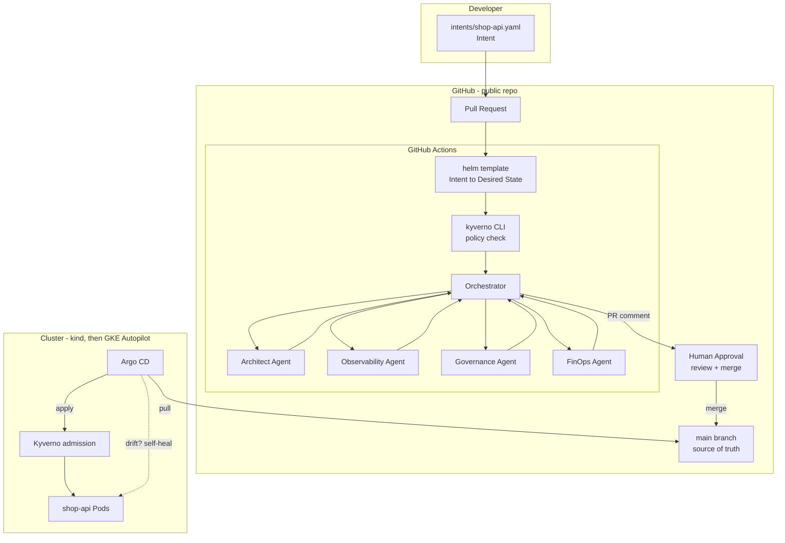
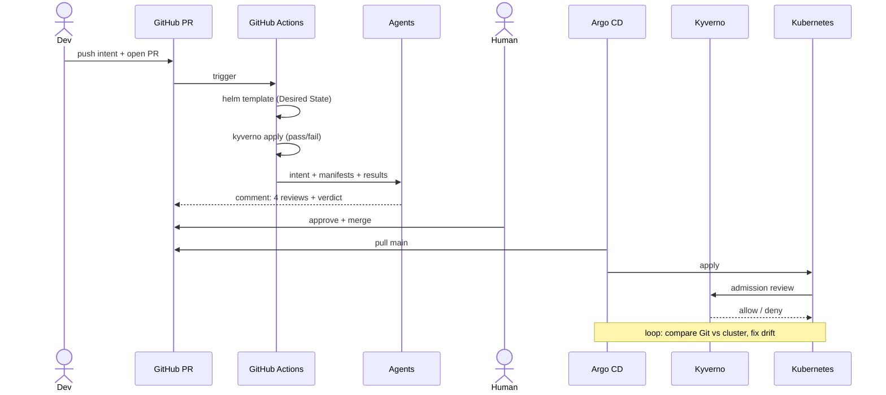
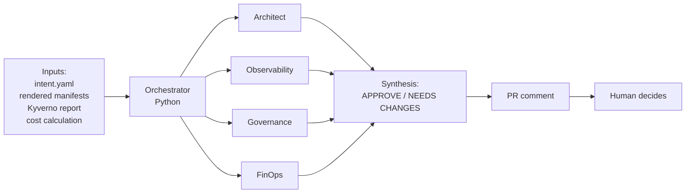

# NEXUS - Architecture

NEXUS is a small Intent-Driven platform. A developer writes a short **Intent** file; the platform
turns it into a Kubernetes **Desired State**, checks it against policies, has four AI agents review
it in a Pull Request, waits for a **human approval**, and lets GitOps apply and protect it.

## Overview

## Layers

| Layer | Role | Implementation |
|---|---|---|
| Intent | Developer interface: ~10 lines of YAML | `intents/*.yaml` |
| Translation | Golden Path: Intent -> manifests | Helm chart `platform/golden-path` |
| Governance | Rules as code, checked twice (CI + admission) | Kyverno, `policies/` |
| Intelligence | Four specialised reviews + synthesis | `agents/` (Python + LLM) |
| Approval | A human decides | GitHub PR + branch protection |
| Delivery | Git -> cluster, continuously | Argo CD, `gitops/` |
| Runtime | Where Pods run | kind (dev), GKE Autopilot (demo) |

## Data flow

## Two reconciliation loops

- **Kubernetes reconciliation**: controllers compare the object stored in the API (e.g. a
  Deployment asking for 2 replicas) with reality (running Pods) and fix reality.
- **GitOps reconciliation**: Argo CD compares Git with the objects stored in the API and fixes the
  API objects.

Git -> API (Argo CD), then API -> reality (Kubernetes).

## Agents

These are role agents inside an orchestrated workflow. They advise; they never act on the cluster.

## Security boundaries

- Agents and CI hold only the workflow `GITHUB_TOKEN`. No kubeconfig, no cloud credentials.
- Argo CD uses a **pull** model: no cluster credential ever leaves the cluster.
- Kyverno admission is the last line of defence, even against a direct `kubectl apply`.
- `main` is protected: PR, one approval and green CI are required.
- No secrets in this repository. The repo is public and Argo CD reads it anonymously.

## Network

- No Load Balancer, no Ingress, no static IP, no Cloud NAT.
- Services are `ClusterIP`; access is through `kubectl port-forward` only.

## IAM (GCP)

- A dedicated project, owned by the student account. No service account keys.
- In the cluster: Argo CD default RBAC; application Pods have no API permissions.
